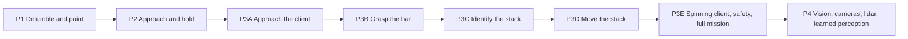

# mjorbit-exp: learning space robotics, from detumbling to satellite capture

A self-directed programme in spacecraft control and space robotics, built on the [mjorbit](https://github.com/johnzhang3/mjorbit) orbital simulator (MuJoCo with orbital dynamics). It works up from stopping a spinning spacecraft to an arm-equipped servicer that flies to a spinning client satellite, grasps its grapple bar, identifies the joined stack and moves it. The current stage learns to see the client with cameras and a flash lidar.

Each project follows the same method: measure the physics first, build a strong classical baseline, add learning only where it earns its place, and judge everything on held-out validation and a test set used once.



## Results so far

| Project | What it does | Headline result |
|---|---|---|
| **P1** Detumble and point | PPO vs a damping controller on a 10 kg spacecraft | Detumble: PPO ties the classical law (100%, 5.15 s vs 5.2 s, test). Pointing: 0.028° final error, test |
| **P2** Approach and hold | Rendezvous with a co-orbiting satellite under thrust errors, disturbances and sensor noise | Shielded residual policy: 99.2% success, **0 collisions**, 5.7% less fuel than shielded CW targeting (1000 test cases, run once). A classical glideslope later beat both |
| **P3A** Approach | Kalman filter, glideslope and corridor routing to a pre-grasp point | 100% success, 0 collisions, 0 corridor violations |
| **P3B** Grasp | IK reach, impedance approach, jaw close on a prepared grapple bar | 100% over 200 randomised cases, client push < 1 mm/s |
| **P3C** Identify | Momentum-based mass-property identification of the captured stack | Mass, inertia and centre of mass to 0.1–0.3% and 2.5 mm |
| **P3D** Move | Reposition 5–15 m and reorient 30–120° with momentum unloading | 40 of 40 within 7 cm and 0.26° |
| **P3E** Full mission (E3) | Approach, fly-in, capture of a client spinning up to 2°/s, stack control, with fault monitors and aborts | **0 unsafe outcomes** on 300 test missions (85.7% success, 100% safe); the same on a rideshare-sized ESPA servicer with no tuning (84.7%, 100% safe) |
| **P4** Vision (in progress) | Wrist and bus cameras plus a flash lidar; a learned bar-pose estimator feeding the classical grasp | v1 estimator 11.7 mm while approaching, limited by uncalibrated sensor mounts; v2 (calibrated sensors) training now, target about 5 mm |

Full numbers, failures and the reasoning behind every choice are in the specs (`projects/*/SPEC*.md`) and in [learning/LEARNINGS.md](learning/LEARNINGS.md).

## Lessons that recur

- **A strong classical baseline is hard to beat.** Learning tied or lost to the right classical law in every idealised setting. It earned its place under uncertainty and as a residual on a strong base.
- **Check the simulator before the controller.** Friction creep, springy jaws and missing torsional friction were simulator settings, and each would have looked like a control or estimation bug.
- **Safety needs its own evidence.** Rare failures only appeared at 1000 cases; monitors had to detect the fault (a thruster residual in 0.2 s), not its symptom (tracking error after 15–40 s).
- **Keep score honestly.** Validation for every choice, a test set used once, and freezes (`*.sha256`) that record which code produced each result.

## Repository layout

```
projects/
  p1_detumble/   detumble and pointing envs, PPO training, baselines      SPEC.md, SPEC_1B.md
  p2_approach/   rendezvous envs, CW and glideslope guidance, Kalman
                 filter, safety shield, residual RL                         SPEC_2.md
  p3_capture/    servicer scenes, grasp and stack simulation, guidance,
                 fly-in, safety monitors, robot description layer,
                 whole-mission Monte Carlo (E3)                             SPEC_3.md
  p4_vision/     camera and lidar rig, domain randomisation, demonstration
                 recorder, pose-estimator network, Colab notebooks          SPEC_4.md
learning/        curriculum, research notes, lessons learned, project guide
tools/           helper scripts (run commands in the simulator's GPU env)
CONTEXT.md       running project log and where to resume
LOCAL_SETUP.md   how the simulator was installed and verified
```

## Getting started

**Requirements:** Linux or Windows with WSL2 (Ubuntu), an NVIDIA GPU for training (developed on an RTX 4060 Laptop, 8 GB), and [pixi](https://pixi.sh).

1. Clone this repository, then clone the simulator into `simulator/` inside it:
   ```bash
   git clone https://github.com/shrey160/mjorbit-exp.git
   cd mjorbit-exp
   git clone https://github.com/johnzhang3/mjorbit.git simulator
   ```
   Developed against mjorbit commit `a09090671fe6299b1085d235623e4b2d00b4e675`.
2. Install the simulator's environments with pixi (`default` for the CPU backend and viewer, `rl` for GPU training). [LOCAL_SETUP.md](LOCAL_SETUP.md) records the exact steps, versions (MuJoCo 3.7.0, PyTorch 2.13, mujoco-warp 3.7.0.1) and checks.
3. Run project scripts through the `rl` environment from the simulator root, for example:
   ```bash
   bash tools/rlrun.sh python ../projects/p2_approach/evaluate.py --env maneuver --unc u1
   ```

**Note on paths:** the helper scripts (`tools/rlrun.sh`, the `run_*.sh` files) contain this machine's absolute paths (`/mnt/c/Shrey_Projs/...`, the pixi location under `/home/shrey31`). Edit them for your own setup.

**Examples:**
```bash
# whole-mission Monte Carlo on the ESPA servicer: split and number of missions
bash projects/p3_capture/run_e3_espa.sh validation 20

# generate the P4 camera scene, then record camera/lidar demonstrations of the classical grasp
bash projects/p4_vision/run_p4.sh make_scene.py
bash projects/p4_vision/run_p4.sh gen_demos.py --split demo --n 4 --workers 4 --out /tmp/demos
```

## What is not in this repository

- **The simulator:** clone [mjorbit](https://github.com/johnzhang3/mjorbit) into `simulator/` (above).
- **Generated data:** results, logs, demonstrations, packed datasets, model checkpoints, images and PDFs (see [.gitignore](.gitignore)). The specs record every result in tables.
- **`projects/p3_capture/p4_espa_cam_scene.xml`:** generate it with `projects/p4_vision/make_scene.py`.

## Status and next steps

- **P4.3 (now):** train the v2 pose estimator (calibrated sensor mounts, bus camera 192 px, lidar 128 px), then run the classical grasp on its estimates against the grasp on the true pose.
- **P4.4–P4.7:** an imitation-learned grasp (ACT, then Diffusion Policy) with LeRobot, DAgger, and the P3E safety monitors kept as a shield.
- [CONTEXT.md](CONTEXT.md) has the detailed state and how to resume.

## Documentation

| Document | Purpose |
|---|---|
| [learning/LEARNINGS.md](learning/LEARNINGS.md) | What happened in each project, and the lessons |
| [learning/PROJECT_GUIDE.md](learning/PROJECT_GUIDE.md) | A long-form guide from "what is a physics engine" to every design decision |
| [learning/RESEARCH_SERVICING.md](learning/RESEARCH_SERVICING.md) | Research on real servicing missions and on learning for capture |
| [learning/CURRICULUM.md](learning/CURRICULUM.md) | The original twelve-week learning plan |
| `projects/*/SPEC*.md` | Per-project specification, design, results and history |

## Acknowledgements

- [mjorbit](https://github.com/johnzhang3/mjorbit) by John Zhang: the orbital simulator everything here runs on.
- [MuJoCo](https://mujoco.org) and [MuJoCo Warp](https://github.com/google-deepmind/mujoco_warp).
- Built with help from Claude (Anthropic) as a coding assistant.

## License

No license has been chosen yet, so all rights are reserved by default. Open an issue if you would like to reuse something.
